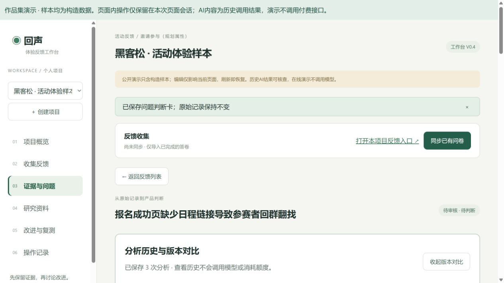

# 回声 · AI 用户反馈分析与改进工作台

面向产品与运营的个人作品集：将原始反馈转成可核对的证据、信息缺口、待验证假设与改进事项。

## 面试官从这里开始
1. 阅读 [三页项目说明](PORTFOLIO.md)：问题、设计和失败迭代。
2. 运行公开演示，查看 E01、E04、E07 的 AI 历史版本；样本均为构造数据，预录结果不冒充实时生成。
3. 查看 [评测对比](docs/comparison-v2-v3.md) 和 [结构化输出复测](docs/report-v4.md)。

## 快速运行（Node.js 22.12+）
```sh
npm ci
npm test
npm run build:demo
npm run preview
```
打开终端显示的地址。演示复用实际React界面，浏览器本地存储替代后端；可查看历史、编辑判断和创建改进项。保存后的修改刷新仍保留；不跨设备同步，清除网站数据会删除本地记录，请使用“导出项目记录”备份。不需要密钥、不发送用户输入。

## 本地真实API模式
复制 `.env.example` 为 `.env.local`，在本地填写自己的 DeepSeek 密钥。两个终端分别运行 `npm run server` 与 `npm run dev`。接口只监听本机，AI调用会产生个人用量。公开仓库没有密钥、公司数据或原始账号配置。

## 实现范围
已实现：三类项目、反馈录入、人工分类/合并、判断卡、改进记录、AI结构化分析、原文核验、版本对比。
未实现：自动聚类、自动竞品研究、多用户权限、生产部署。语义正确性仍需人工审核。

## 开源复用与作者贡献
本工作台独立开发，使用Codex辅助编码。原型曾连接独立运行的 [Formbricks](https://github.com/formbricks/formbricks) 收集问卷，没有修改其核心源码；公开版移除私人数据库连接器，保留映射逻辑和自有表单。没有打包Formbricks代码或企业版功能。不能称为Formbricks核心源码深度二次开发。
产品贡献包括场景与需求拆解、审核交互、证据字段设计、评价标准及失败迭代。评测为构造样本的AI辅助审阅，不是独立人工盲评或商业增长效果。

## 发布演示
GitHub Pages 使用静态文件，不承载本项目的Node后端。仓库Settings → Pages → Source选择GitHub Actions，运行Pages工作流即可发布不含密钥的演示。

## 许可
本仓库自有代码使用MIT许可；依赖按各自许可分发，见 [第三方说明](THIRD_PARTY_NOTICES.md)。Formbricks独立项目不受本仓库MIT许可覆盖。

## 演示截图




## 今日交付
- [作品集案例](PORTFOLIO.md)
- [三分钟演示稿](docs/DEMO_GUIDE.md)
- [发布验收与边界](docs/RELEASE.md)
- [可浏览的作品集页面](docs/portfolio.html)

公开演示仅支持本机浏览器保存，不承诺未保存输入、跨设备同步或云端备份。建议展示前保存判断并导出项目记录。
